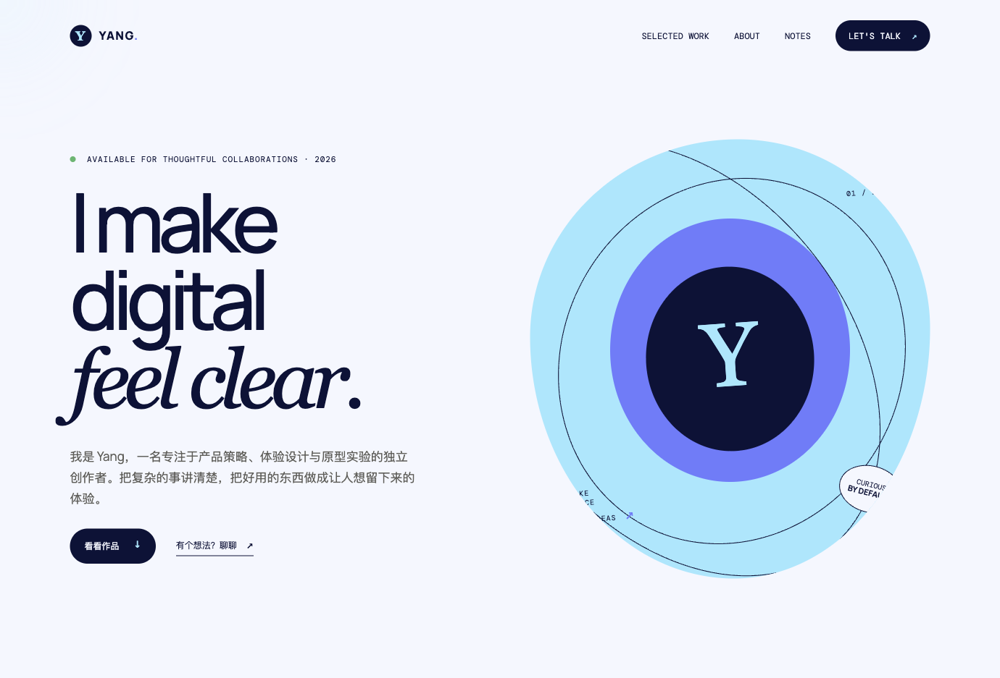

# YANG · 个人作品集

围绕产品思考、体验设计与交互原型的个人展示站，呈现作品集页面的信息组织、视觉表达与基础交互。

[▶ 在线预览](https://a15242408085-bot.github.io/yang-personal-workstation/)

[](https://a15242408085-bot.github.io/yang-personal-workstation/)

本项目是一份静态作品集界面与交互原型。当前项目卡片、笔记和个人介绍中包含示例文案，仅用于展示页面结构与设计表达。

## 页面与交互

- 作品展示、个人介绍、笔记与联系区块。
- 响应式布局与移动端导航。
- 滚动入场、悬停反馈与页面内锚点导航。

## 技术实现

使用 HTML、CSS 与原生 JavaScript，无需安装依赖或构建。页面以相对路径加载样式和脚本，可部署到 GitHub Pages。

## 本地预览

在项目目录运行：

```bash
python3 -m http.server 4173
```

然后在浏览器打开 `http://localhost:4173`。

## 文件说明

- `index.html`：页面结构与内容。
- `styles.css`：视觉样式、响应式布局与动画。
- `script.js`：导航、滚动入场和基础交互。
